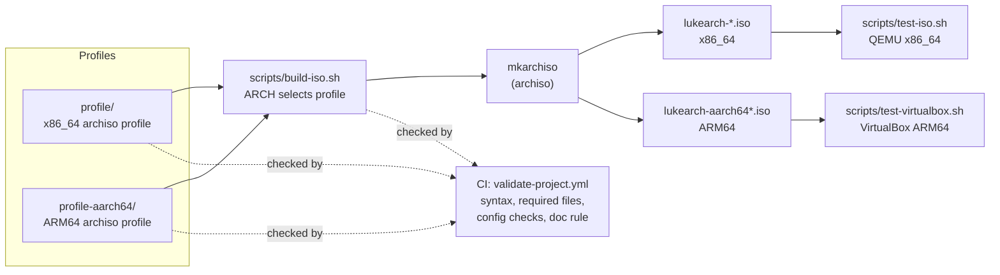
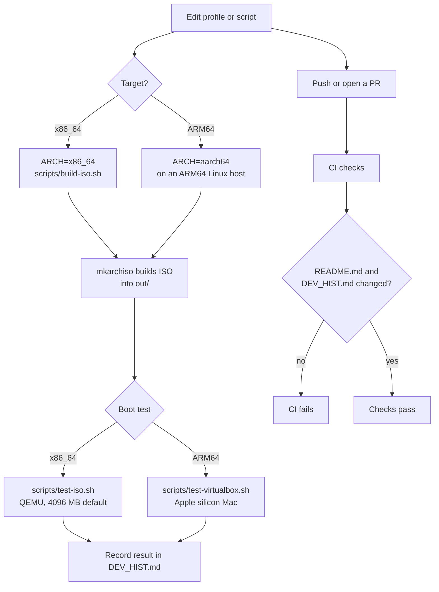
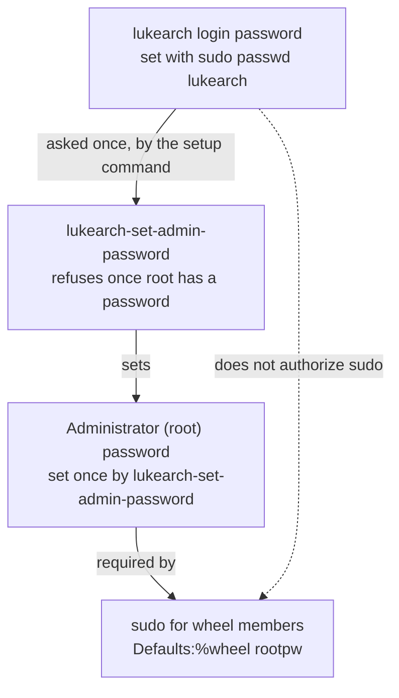

# Lukearch Project Structure

This page is a visual map of the repository: what each part is, how the
parts connect, and how a change moves from source to a tested ISO. It
describes the current tree. [`README.md`](README.md) covers build and usage
steps, and [`DEV_HIST.md`](DEV_HIST.md) records changes over time.

## Overview

Two archiso profiles live in this repository. One build script selects a
profile by architecture, and test scripts boot the result.



## Repository tree

```text
lukearch/
├── .github/
│   └── workflows/
│       └── validate-project.yml     CI checks on every push and pull request
├── docs/
│   └── arm-support.md               ARM and Apple silicon status and roadmap
├── profile/                         x86_64 archiso profile (Intel and AMD PCs)
│   ├── profiledef.sh                build metadata, boot modes, file permissions
│   ├── packages.x86_64              live environment package list
│   ├── pacman.conf                  repositories for the x86_64 build
│   ├── efiboot/loader/              systemd-boot config and boot entries (UEFI)
│   ├── syslinux/syslinux.cfg        BIOS boot menu
│   └── airootfs/                    files copied into the live root filesystem
│       ├── etc/                     hostname, os-release, motd, nftables,
│       │                            SDDM autologin, sudoers, zram
│       ├── root/                    customize script and live README
│       └── usr/local/sbin/          lukearch-set-admin-password
├── profile-aarch64/                 ARM64 archiso profile (VirtualBox on Apple silicon)
│   ├── profiledef.sh                build metadata, boot mode, file permissions
│   ├── packages.aarch64             live environment package list
│   ├── pacman.conf                  Arch Linux ARM repositories
│   ├── efiboot/loader/              systemd-boot config and boot entry (UEFI)
│   └── airootfs/                    same role as the x86_64 airootfs
├── scripts/
│   ├── build-iso.sh                 builds an ISO with mkarchiso (ARCH selects profile)
│   ├── test-iso.sh                  boots an x86_64 ISO in QEMU
│   └── test-virtualbox.sh           creates and starts an ARM64 VirtualBox VM
├── DEV_HIST.md                      dated development history
├── README.md                        overview, build, test, and security notes
├── STRUCTURE.md                     this file
├── LICENSE
└── .gitignore                       ignores work/, out/, and *.iso
```

## Build and test flow



## Live image authentication model

Members of the `wheel` group, including the `lukearch` desktop account, use
sudo. Sudo asks for a separate administrator (root) password. The login
password does not authorize sudo.



## Where things are documented

| Topic | Where to look |
| --- | --- |
| Build and test commands, security notes | [`README.md`](README.md) |
| ARM and Apple silicon status | [`docs/arm-support.md`](docs/arm-support.md) |
| Change history and validation notes | [`DEV_HIST.md`](DEV_HIST.md) |
| Automated checks | [`.github/workflows/validate-project.yml`](.github/workflows/validate-project.yml) |
