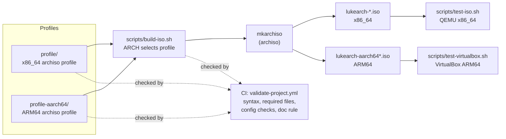
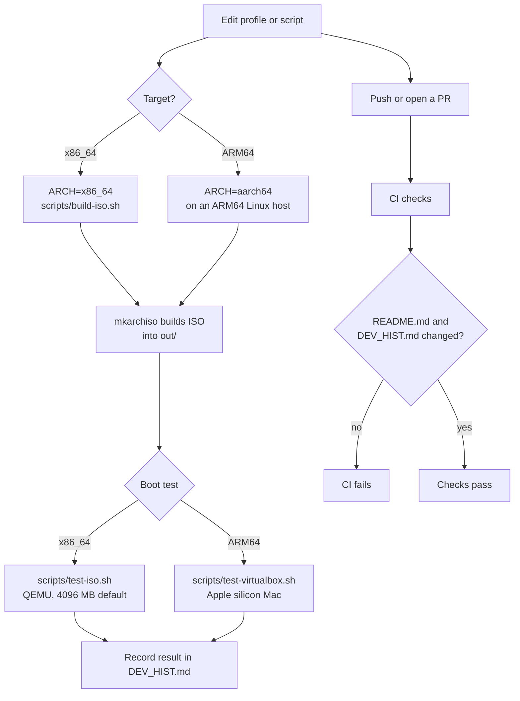
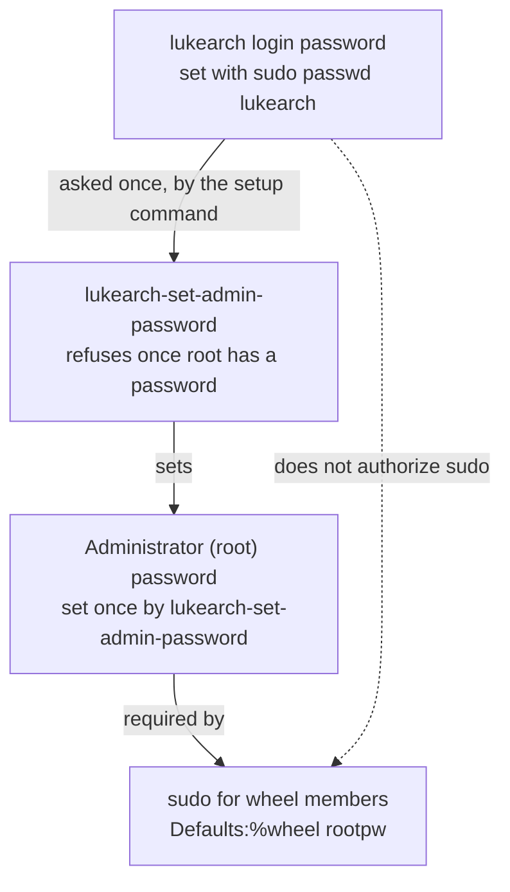

# Lukearch Project Structure

This page is a visual map of the repository: what each part is, how the
parts connect, and how a change moves from source to a tested ISO. It
describes the current tree. [`README.md`](README.md) covers build and usage
steps, and [`DEV_HIST.md`](DEV_HIST.md) records changes over time.

**Keeping this page current:**

- The file tree below is generated from tracked files by
  `scripts/update-structure.sh`. Run it after adding, moving, or removing
  files. CI fails if the tree is out of date.
- The diagrams and the key-directories table are edited by hand. Update them
  when a component, flow, or responsibility changes.

## Overview

Two archiso profiles live in this repository. One build script selects a
profile by architecture, and test scripts boot the result.



## Repository tree

<!-- tree:start -->
```text
.github/
  workflows/
    validate-project.yml
.gitignore
DEV_HIST.md
LICENSE
README.md
STRUCTURE.md
docs/
  arm-support.md
profile-aarch64/
  airootfs/
    etc/
      hostname
      locale.conf
      locale.gen
      mkinitcpio.conf.d/
        archiso.conf
      nftables.conf
      sddm.conf.d/
        autologin.conf
      sudoers.d/
        lukearch
      systemd/
        zram-generator.conf
      udev/
        rules.d/
          71-lukearch-framebuffer-seat.rules
    root/
      README
      customize_airootfs.sh
    usr/
      local/
        sbin/
          lukearch-set-admin-password
  efiboot/
    loader/
      entries/
        lukearch-aarch64.conf
      loader.conf
  packages.aarch64
  pacman.conf
  profiledef.sh
profile/
  airootfs/
    etc/
      hostname
      locale.conf
      locale.gen
      mkinitcpio.conf.d/
        archiso.conf
      motd
      nftables.conf
      os-release
      sddm.conf.d/
        autologin.conf
      sudoers.d/
        lukearch
      systemd/
        system/
          multi-user.target.wants/
            NetworkManager.service
        zram-generator.conf
    root/
      README
      customize_airootfs.sh
    usr/
      local/
        sbin/
          lukearch-set-admin-password
  efiboot/
    loader/
      entries/
        lukearch-x86_64-copytoram.conf
        lukearch-x86_64.conf
      loader.conf
  packages.x86_64
  pacman.conf
  profiledef.sh
  syslinux/
    syslinux.cfg
scripts/
  build-iso.sh
  test-iso.sh
  test-virtualbox.sh
  update-structure.sh
```
<!-- tree:end -->

## Key directories

| Path | Purpose |
| --- | --- |
| `profile/` | x86_64 archiso profile for Intel and AMD PCs |
| `profile/airootfs/` | Files copied into the x86_64 live root filesystem |
| `profile/efiboot/` and `profile/syslinux/` | UEFI (systemd-boot) and BIOS (syslinux) boot configuration |
| `profile-aarch64/` | ARM64 archiso profile for VirtualBox on Apple silicon |
| `profile-aarch64/airootfs/` | Files copied into the ARM64 live root filesystem |
| `scripts/` | Build, QEMU test, VirtualBox test, and structure generator scripts |
| `docs/` | Supporting documentation (ARM and Apple silicon status) |
| `.github/workflows/` | CI validation |

## Build and test flow



## Live image authentication model

Members of the `wheel` group, including the `lukearch` desktop account, use
sudo. Sudo asks for a separate administrator (root) password. The login
password does not authorize sudo.



## Where things are documented

| Topic | Where to look |
| --- | --- |
| Build and test commands, security notes | [`README.md`](README.md) |
| ARM and Apple silicon status | [`docs/arm-support.md`](docs/arm-support.md) |
| Change history and validation notes | [`DEV_HIST.md`](DEV_HIST.md) |
| Automated checks | [`.github/workflows/validate-project.yml`](.github/workflows/validate-project.yml) |
